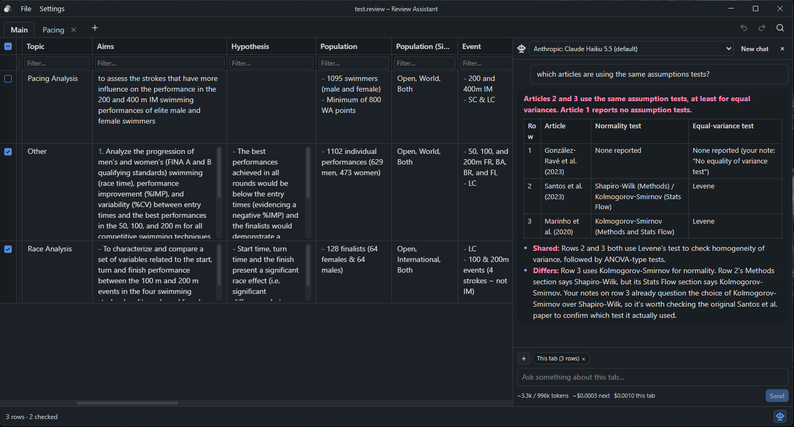

# Review Assistant

A desktop app for writing good notes on many academic articles and analysing sub-groups of them. Built for literature, scoping and systematic reviews.

You keep one table of articles with the columns you choose, group articles into tabs (e.g. *RCTs*, *Elite swimmers*) without copying them, and search, filter and export the lot. An AI assistant is available if you want one, but it's optional help, never the point: **everything works with no API key.**

> If you like the program and want to support what I am doing, feel free to [buy me a coffee](https://buymeacoffee.com/akussauer)




## Features

- **A review is a file.** Each review is one `.review` file you open, create and "save as" like a document. Every edit is saved automatically. There is no Save button and no unsaved changes.
- **Your own columns.** Text (multiline, with markdown highlighting and spellcheck), dropdown, checkbox, date and number. Rename, retype, reorder and resize them. New reviews start from a sensible template (Title, Study Type, Author(s), Year, Notes, …).
- **Tabs for sub-groups.** A tab is a list of links to rows in the main table, not a copy. Edit a cell anywhere and every tab shows the change.
- **Search and filters.** PubMed-style search (`AND`, `OR`, `NOT`, `"exact phrases"`, `swim*` wildcards) with match highlighting, a filter under every column (`>2015`, `2010..2020` for numbers and dates), and sorting. Each tab remembers its own.
- **Import and export.**
  - **CSV** that opens cleanly in Excel.
  - **JSON** in a documented format ([docs/json-format.md](docs/json-format.md)) that can be imported again.
  - **Markdown**: one note per article, ready for an [Obsidian](https://obsidian.md) vault, with YAML properties and tags from the tabs the article is in.
- **Optional AI assistant, read-only.** Each tab can have its own chat that sees that tab's rows. It can answer questions about your notes but can never change them. See [AI and privacy](#ai-and-privacy).
- **Use Claude Desktop instead.** With a Claude Pro or Max subscription you can chat about the open review in Claude Desktop, with no API key and no API costs. Setup: [docs/mcp.md](docs/mcp.md).
- **Looks how you like.** Light, dark or system theme, any installed [Obsidian theme](https://obsidian.md/themes), and adjustable markdown and highlight colours.
- **Four languages.** English, German, French and Spanish, with spellcheck in up to three languages at once.
- **Plugin groundwork.** Plugin folders can be installed, enabled, disabled and removed. The plugin API itself is still to come (see [Planned](#planned)).

## Install (Windows)

1. Download `ReviewAssistant-<version>-setup.exe` from the [latest release](https://github.com/akussauer/ReviewAssistantElectron/releases/latest).
2. Run it. The installer isn't code-signed yet, so Windows SmartScreen will warn you: click **More info**, then **Run anyway**.
3. Click through the wizard. It installs for your user only and needs no administrator rights.

`.review` files then open in the app when double-clicked. Updating, uninstalling and where settings are stored: [docs/install.md](docs/install.md).

Windows only for now; macOS and Linux are planned.

## AI and privacy

The assistant is off until you set it up in **Settings → Preferences**. Supported providers:

- **OpenRouter** (the default): many models with one key.
- **Anthropic** (Claude) through Anthropic's own API.
- **Any OpenAI-compatible endpoint.**
- **Ollama**: models running on your own computer.

What leaves your computer, and when:

- **None of your review data**, unless you send a message. With a provider set up, the app checks the key at startup; that call doesn't include your review.
- (Separately, spellcheck downloads a dictionary once if you pick a language other than English, German, French or Spanish.)
- When you send a message, it goes to the provider you chose, together with the rows currently shown in that tab and any `.txt`, `.md` or PDF files you attached. You can remove the rows from a single message.
- With **Ollama**, everything stays on your computer.
- Your API key is stored encrypted by Windows and is never visible to the app's interface.

The assistant has no way to write to your review. Neither does the Claude Desktop connection, which is off by default and only reads the review that is open in the app.

## Planned

- **Synthesis tabs**: summarise each column across a tab's articles, with editable results.
- **A plugin API** for developers to extend the app.
- **macOS and Linux** builds.
- **A code-signed installer**, so SmartScreen stops warning.

---

## For developers

**Stack:** Electron (electron-vite) · TypeScript (strict) · React · Tailwind · shadcn/ui · TanStack Table + Virtual · Zustand · better-sqlite3 · Zod · Vitest · electron-builder.

### Architecture

```
renderer (React UI)  ──window.api──▶  preload  ──IPC──▶  main (Node)
   no DB, no files,                  typed bridge        validates every payload with Zod,
   no API keys                                           owns the SQLite file, LLM calls,
                                                         settings, menus, file dialogs
```

- One open `.review` file = one better-sqlite3 connection in main (`journal_mode=DELETE`). Every change is written immediately.
- IPC channels and payload types live in `src/shared/ipc.ts`; their Zod schemas in `src/shared/schemas.ts`.
- Schema changes are new numbered migrations (`src/main/db/migrations.ts`). Destructive operations take a backup and run in one transaction.
- The assistant is read-only: no code path lets model output write to rows or columns.
- Claude Desktop runs `src/mcp/server.ts` (bundled into a `.mcpb` extension), which asks the running app for data over a local named pipe.

The full rules are in [CLAUDE.md](CLAUDE.md), the behaviour in [docs/spec.md](docs/spec.md), and the milestones in [docs/plan.md](docs/plan.md).

### Where the code lives

| Folder | What's in it |
|---|---|
| `src/main/` | Electron main process: app lifecycle, menus, title bar, settings, themes, plugins, spellcheck, i18n |
| `src/main/db/` | The `.review` file: opening, migrations, rows, columns, cells, tabs, SQL views, import, export, backups |
| `src/main/ipc/` | IPC handler registration and validation |
| `src/main/llm/` | Assistant providers, key checks, chat, attachments (PDF text extraction) |
| `src/main/mcp/` | Claude Desktop connection: pipe server, read-only tools, `.mcpb` bundling |
| `src/mcp/` | The MCP script Claude Desktop runs |
| `src/preload/` | The `window.api` bridge |
| `src/renderer/src/` | React UI: `components/` (ReviewTable, Tabs, Assistant, Settings, Export, TitleBar, Welcome, `ui/` for shadcn), `store/` (Zustand), `lib/` |
| `src/shared/` | Code used by both sides: IPC types, Zod schemas, search syntax, type conversion, translations (`i18n/`) |

### Commands

```bash
npm install        # also rebuilds better-sqlite3 for Electron
npm run dev        # run the app with hot reload
npm run typecheck
npm run lint
npm test           # Vitest, run inside Electron's Node (see scripts/test.mjs)
npm run build:win  # Windows installer → dist/ReviewAssistant-<version>-setup.exe
```

Tests run inside Electron's Node, not your system Node, because better-sqlite3 is compiled for Electron.

### Runtime paths

- Settings, encrypted API key, themes, plugins, dictionaries, backups: `%APPDATA%\ReviewAssistant`
- Logs: `%APPDATA%\ReviewAssistant\Logs\app.log` (rotates at 5 MB, 3 files kept)

### Adding shadcn/ui components

`npx shadcn@latest add <component>` writes into `src/renderer/src/components/ui/`.

## Contributing

Bug reports and suggestions are welcome in [GitHub Issues](https://github.com/akussauer/ReviewAssistantElectron/issues). If you'd like to send a pull request, please open an issue first so we can agree on the approach.

## License

[MIT](LICENSE) © 2026 Alex Kussauer
